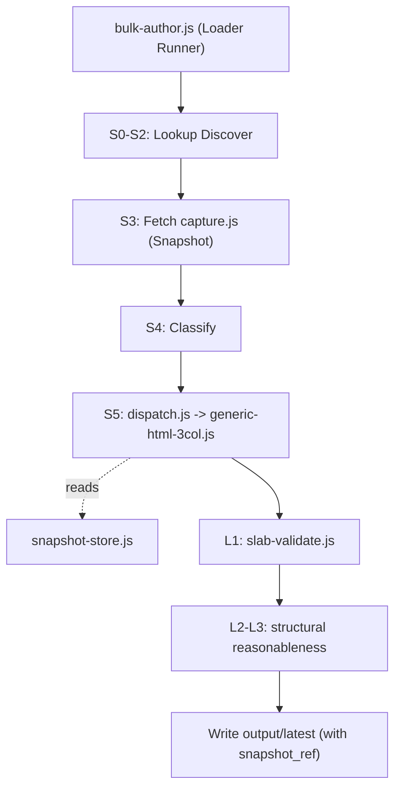

# Public Sector Bank Rate Extraction — Implementation Plan (v2 Architecture)

> **Scope:** All 12 Public Sector Banks (PSBs) + 7 PSB IBU entities = **19 total entries**
> **Variants:** Domestic FD + NRE + NRO + FCNR (parent banks) · GIFT City (IBU entries)
> **Source registry:** `data/Indian_Banks_Comprehensive_List_RBI.csv`
> **Reference docs:** `docs/agent/rewrite/design.md`, `docs/agent/rewrite/functional-spec.md`, `docs/agent/discovery-workflow.md`
> **Environment:** Local only (Cloud/WAF restrictions ignored)

---

## Context & Goal

Public Sector Banks offer the **full NRI product suite** — NRE, NRO, FCNR, and (for 7 of them) GIFT City IBU deposits. This plan extracts all rate variants in a single pipeline run, using the **v2 snapshot-first architecture**.

**Output files per parent bank (up to 5):**

| File | Variant | Applies to |
|------|---------|-----------|
| `output/latest/<bank_code>_config.json` | — | All 19 entries |
| `output/latest/<bank_code>_rates.json` | `regular` | 12 parent PSBs |
| `output/latest/<bank_code>_nre_rates.json` | `nre` | 12 parent PSBs |
| `output/latest/<bank_code>_nro_rates.json` | `nro` | 12 parent PSBs |
| `output/latest/<bank_code>_fcnr_rates.json` | `fcnr` | 12 parent PSBs |
| `output/latest/<bank_code>_gift_rates.json` | `gift` | 7 IBU entities only |

> [!NOTE]
> Every output envelope carries `instrument_type: "deposit"` and `schema_version`. Every rate file MUST carry a `snapshot_ref`. Without a `snapshot_ref`, the file will fail L1 validation. IBU entities have no domestic INR FD products; they operate exclusively in foreign currency in GIFT City. 

---

## Bank Register

### Parent PSBs (12) — Domestic FD + NRI Variants

| # | Bank Name | `bank_code` | HQ State | Has IBU? |
|---|-----------|-------------|----------|:--------:|
| 1 | State Bank of India | `state-bank-of-india` | Maharashtra | ✅ |
| 2 | Bank of Baroda | `bank-of-baroda` | Gujarat | ✅ |
| 3 | Bank of India | `bank-of-india` | Maharashtra | ✅ |
| 4 | Bank of Maharashtra | `bank-of-maharashtra` | Maharashtra | ✅ |
| 5 | Canara Bank | `canara-bank` | Karnataka | ✅ |
| 6 | Central Bank of India | `central-bank-of-india` | Maharashtra | ❌ |
| 7 | Indian Bank | `indian-bank` | Tamil Nadu | ✅ |
| 8 | Indian Overseas Bank | `indian-overseas-bank` | Tamil Nadu | ❌ |
| 9 | Punjab National Bank | `punjab-national-bank` | Delhi | ✅ |
| 10 | Union Bank of India | `union-bank-of-india` | Maharashtra | ❌ |
| 11 | Punjab & Sind Bank | `punjab-sind-bank` | Delhi | ❌ |
| 12 | UCO Bank | `uco-bank` | West Bengal | ❌ |

### PSB IBU Entities (7) — GIFT City Rates Only

| # | Bank Name | `bank_code` | Parent PSB |
|---|-----------|-------------|-----------|
| 1 | State Bank of India - IBU | `state-bank-of-india-ibu` | State Bank of India |
| 2 | Bank of Baroda - IBU | `bank-of-baroda-ibu` | Bank of Baroda |
| 3 | Bank of India - IBU | `bank-of-india-ibu` | Bank of India |
| 4 | Bank of Maharashtra - IBU | `bank-of-maharashtra-ibu` | Bank of Maharashtra |
| 5 | Canara Bank - IBU | `canara-bank-ibu` | Canara Bank |
| 6 | Indian Bank - IBU | `indian-bank-ibu` | Indian Bank |
| 7 | Punjab National Bank - IBU | `punjab-national-bank-ibu` | Punjab National Bank |

---

## Field Learnings & Variant Rules

Based on `field-learnings.md` and `functional-spec.md`, the pipeline applies these strict constraints to extracted slabs:

| Variant | Currency | Senior Premium | Min Tenure | Max Tenure | Rate Bounds |
|---------|----------|----------------|------------|------------|-------------|
| **Domestic**| INR | ✅ Applied | 7 days | 10 years | 1.5% - 9.5% |
| **NRE** | INR | ✅ Same as dom. | 365 days | 10 years | 2.0% - 9.5% |
| **NRO** | INR | ✅ Same as dom. | 7 days | 10 years | 2.0% - 9.5% |
| **FCNR**| USD, GBP, EUR, etc. | ❌ `null` | **365 days** | 5 years | 0.5% - 8.0%* |
| **GIFT**| USD, GBP, EUR, etc. | ❌ `null` | **7 days** | 5 years | 0.5% - 8.0%* |

> *`LOW_YIELD_CURRENCIES` (JPY/CHF) have an override to 0% - 3.0% floor to avoid dropping genuine low yields.
> **Note on GIFT Tenure:** GIFT City IBU deposits are offshore, thus exempt from the RBI's onshore 365-day FCNR minimum (reduced to 7 days).

### Critical Playbook Constraints
1. **Domain Preference:** RBI-mandated `.bank.in` domains MUST be preferred over `.com`/`.co.in` domains. Never use aggregator sites.
2. **Playwright Flags:** When escalating to `html_js`, avoid enabling all flags simultaneously to prevent timeouts. Default to `accordions: true`.
3. **Multi-Currency (Pattern A/B):** For FCNR/GIFT tables, extract EVERY currency column/row. Never collapse to USD-only. Map synonyms (`EURO` -> `EUR`, `YEN` -> `JPY`) via `normalise-currency.js`.
4. **Per-Chunk LLM Errors:** During LLM-assisted table extraction, a "no rates found" error on an informational chunk (e.g., fees) MUST NOT discard valid slabs extracted from a neighboring chunk.
5. **Anti-Fabrication:** All extracts run `assertTraceability` to ensure slabs map to original bytes, enforced before write.

---

## Implementation Phases (v2 Pipeline)

### Phase 1 — Orchestration & Discovery [S0 - S2]

**Goal:** Read registry, build execution queue, and find rate pages.
**Handler:** `lib/orchestrator.js` & `scripts/bulk-author.js`

1. Read `data/Indian_Banks_Comprehensive_List_RBI.csv` for the 19 PSB targets.
2. Lookup `data/bank-domains.json` to find known URLs for domestic and NRI pages.
3. If unknown, run search steps (discover mode): `site:<bank>.bank.in "NRE deposit interest rate"` etc. (prioritizing `.bank.in`).

### Phase 2 — Fetch & Snapshot [S3]

**Goal:** Retrieve content and store raw bytes immutably.
**Handler:** `lib/fetch/fetch-html.js`, `lib/snapshot/capture.js`

1. Fetch the target URL. If HTTP 403/429 or empty DOM is encountered, automatically trigger the Playwright fallback (starting with `accordions: true`).
2. Pass raw HTML/PDF buffer directly to `capture.js`.
3. Save to `output/snapshots/blobs/` and return a `snapshot_ref`.
4. *No extraction occurs here.*

### Phase 3 — Classify & Extract [S4 - S5]

**Goal:** Dispatch to the correct instrument extractor using the snapshot.
**Handler:** `lib/instruments/deposit/extractors/dispatch.js`

1. Classify the page (`html_static`, `html_js`, `pdf`).
2. Dispatch to `generic-html-3col.js` (for standard DOM parsing), `pdf-rate-card.js`, or LLM-fallback chunking.
3. The extractor uses the `snapshot_ref` to read bytes from `output/snapshots/` ensuring full traceability (`assertTraceability`).
4. Extract FCNR/GIFT tables via cross-product column parsing (currency matrix → individual slabs).

### Phase 4 — Validation Checks [L1 - L3]

**Goal:** Validate all slabs via the deposit-specific checks registry.
**Handler:** `lib/instruments/deposit/checks/`

1. **L1 (slab-validate.js):** Ensures structural bounds (e.g. FCNR 365d vs GIFT 7d minimums), schema, required fields (`currency`, `rate_senior_pct = null` for foreign), and applies `normalise-currency.js` standardisation. Fails if `snapshot_ref` is missing.
2. **L2 (structural-checks.js):** Checks ladder plausibility, senior premium logic, FCNR currency sanity.
3. **L3 (rate-reasonableness.js):** Anchors against repo/historical rates and `VARIANT_RATE_RANGES`.

### Phase 5 — Output Writer

**Goal:** Write to `output/latest/` strictly matching `schema.js`.

**Format Notes:**
- Top-level `instrument_type: "deposit"` and `schema_version` must be present.
- Every rates file requires `snapshot_ref: "<hash>"`.

---

## File Map (v2 Structure)

```
lib/
  fetch/
    fetch-html.js            ← fetch logic with Playwright fallback + domain priorities
  snapshot/
    capture.js               ← fetch-time snapshot hook (hard dependency)
    snapshot-store.js        ← put/get blob store
  instruments/
    registry.js              ← instrument plugin registry
    deposit/
      schema.js              ← schema envelopes + identity
      extractors/
        dispatch.js          ← routes to extractor based on config/fingerprint
        generic-html-3col.js ← handles domestic + NRI variants (cross-product for FCNR)
      checks/
        slab-validate.js     ← L1: schema bounds, variant tenure floors, snapshot_ref presence
        structural-checks.js ← L2: FCNR sanity, senior premiums
scripts/
  bulk-author.js             ← runner for extraction
data/
  Indian_Banks_Comprehensive_List_RBI.csv
output/
  latest/
    state-bank-of-india/
      state-bank-of-india_config.json
      state-bank-of-india_rates.json
      state-bank-of-india_nre_rates.json
      ...
```

---

## Execution Order



---

## Risk Register

| Risk | Impact | Mitigation |
|------|--------|-----------|
| JS-rendered rate page (html_js) | Fetch sees empty DOM | `fetch-html.js` automatically escalates to Playwright (with `accordions:true`). |
| PDF-only rate card | Needs OCR/parsing | `dispatch.js` routes to `pdf-rate-card.js` after buffer capture. |
| FCNR multi-currency collapse | Missing currencies | `generic-html-3col.js` handles matrix tables via column tags. USD-only collapse explicitly guarded against. |
| Chunked LLM poison pill | Single chunk failure drops good slabs | `extract_html_table.js` scopes errors per-chunk so informational errors (e.g. fees tables) don't nuke valid slabs. |
| Uncaptured bytes | L1 Validation failure | `capture.js` enforced before `extractors/` can read data. |
| IBU rate page under parent domain | Discovery failure | Runner searches `site:<parent_domain> GIFT City deposit rates`. |

---

## Definition of Done

**General:**
- [ ] Pipeline strictly follows `design.md` v2 modular structure (no `src/scrapers/`).
- [ ] Every fetch results in a snapshot blob in `output/snapshots/blobs/`.
- [ ] Every output file contains `snapshot_ref`, `instrument_type`, and `schema_version`.

**Domestic FD + NRI (12 parent PSBs):**
- [ ] `_config.json`, `_rates.json`, `_nre_rates.json`, `_nro_rates.json`, `_fcnr_rates.json` produced.
- [ ] FCNR slabs respect 365-day min tenure, carry `currency` field and `rate_senior_pct: null`.

**GIFT / IBU (7 IBU entries):**
- [ ] `_config.json` + `_gift_rates.json` produced. 
- [ ] GIFT slabs respect 7-day min tenure, carry `currency` and `rate_senior_pct: null`.
