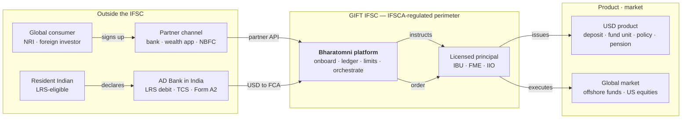
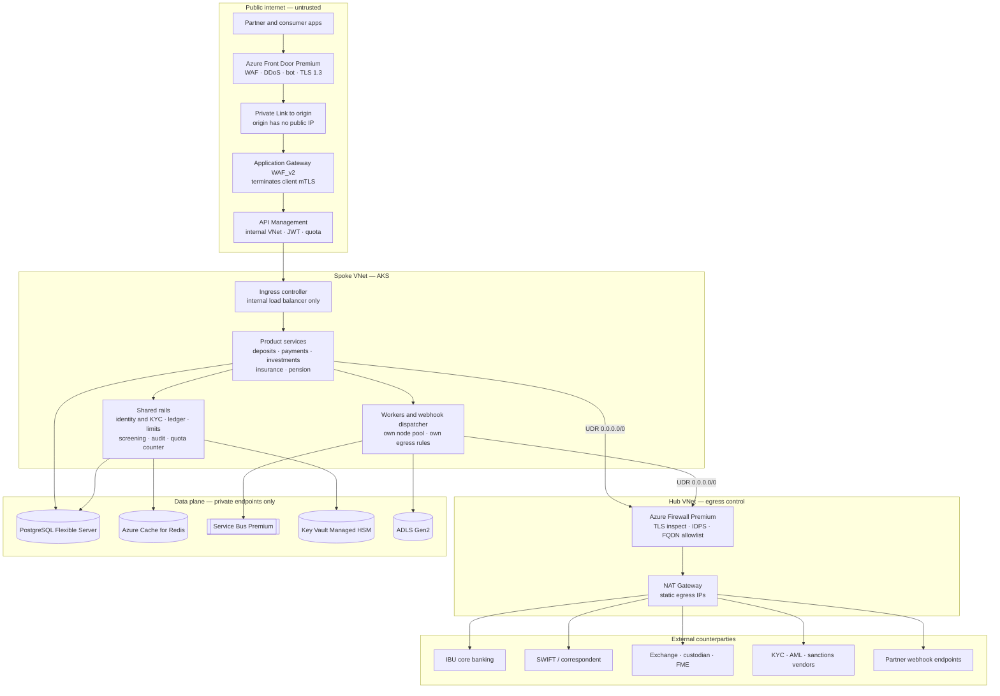
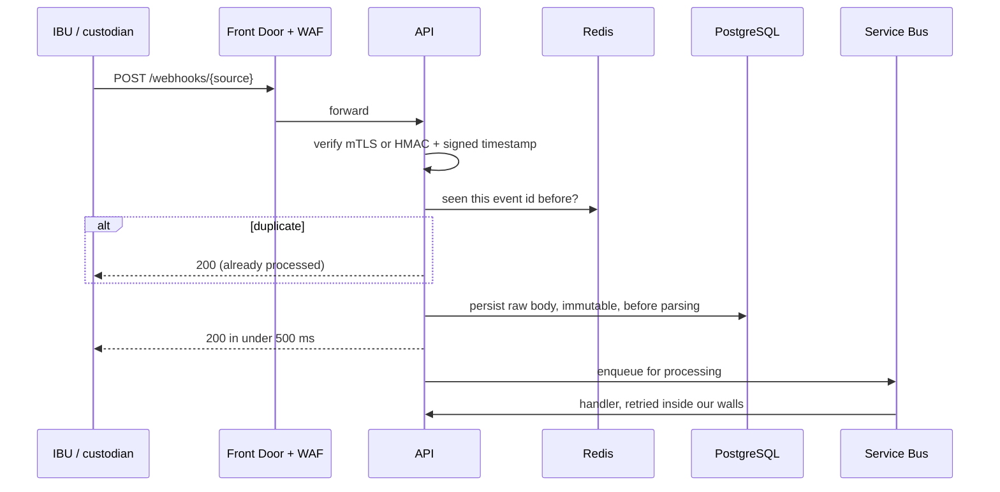
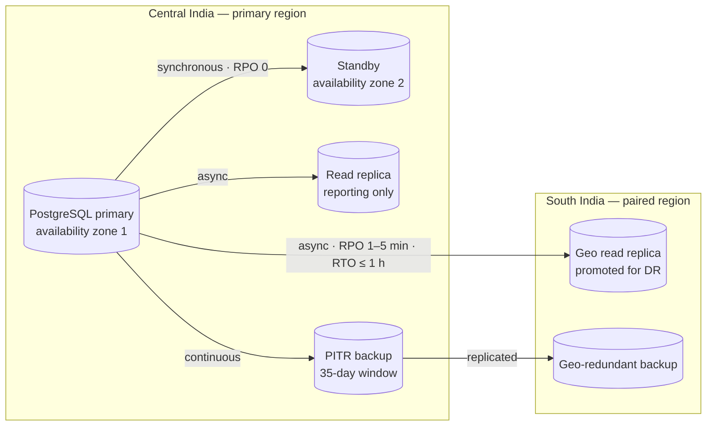

# Bharatomni GIFT Rails — Platform Architecture

**Status:** Draft for review
**Target cloud:** Microsoft Azure — Central India primary, South India paired
**Perimeter:** GIFT IFSC, IFSCA-regulated
**Last updated:** 2026-08-31
**Visual companion:** https://claude.ai/code/artifact/9dd9d104-1c96-4abe-b5d9-7dfc82574d6b

---

## 1. What this document is

This is the Bharatomni-specific architecture: what the platform does, where it sits between a
partner and a licensed principal, and how it is built on Azure — with the five areas that carry the
most regulatory and operational weight worked in depth: **ingress, egress, API security, webhooks,
and database replication**.

The generic multi-tenant mechanics it depends on — row-level-security enforcement, the transactional
outbox, expand/contract migrations, per-tenant fairness, observability, delivery — are in
[`system-design.md`](./system-design.md) and are not repeated here. That document is the platform
core; this one is the business the core has to serve.

### 1.1 What is grounded, and what is inferred

Grounded in what you told me and what is public: Bharatomni is a B2B2C company founded in 2025,
offering API-first infrastructure so banks, NBFCs and fintechs can launch compliant cross-border
products, beginning at GIFT IFSC and covering investment rails, payments, insurance and pension, for
inbound global consumers and outbound resident Indians.

**Everything more specific than that is inferred and needs your correction.** In particular:

| # | Inference | If wrong |
|---|---|---|
| B1 ⚠️ | **You are not the licensed principal.** Partner IBUs, FMEs and insurers hold the licences; you orchestrate and keep the record | If you hold an IFSCA registration directly — PSP under the Payment Services Regulations, distributor, FME — regulatory obligations move inside this platform and Sections 3 and 9 change materially |
| B2 ⚠️ | **All data stays in Indian Azure regions.** Central India primary, South India paired | Any residency or cloud-outsourcing condition from IFSCA or a partner bank redraws Section 8 before anything else |
| B3 | **Scale:** ~200 partners, ~2M end consumers, ~1,500 API req/s peak, < 5 TB transactional data in year two | Every capacity number, and whether the largest partners should be siloed from day one |
| B4 | **USD is the operating currency** inside the IFSC; INR appears only on the onshore leg of an LRS remittance | Multi-currency accounting assumptions in the ledger |
| B5 ⚠️ | **Counterparty APIs are modern** request/response, not file-and-SFTP batch | A batch-and-reconcile workload is a different architecture from the one drawn here. **Mainland bank core systems (§3.3) are the likeliest place this breaks** |
| B6 | **99.9%** availability for the partner API; RPO 5 min, RTO 1 hour | 99.99% would force multi-region active-active, which residency may not even permit |

Regulatory references throughout are for orientation, not a compliance opinion. Confirm each with
counsel and with IFSCA before treating it as a design constraint.

---

## 2. The two flows

Money crosses a regulatory boundary in both directions, and the platform is the middle box in both.



**Inbound** — a global consumer or NRI reaches a product issued inside GIFT IFSC through a partner's
channel. **Outbound** — a resident Indian remits under the Liberalised Remittance Scheme through an
AD Bank into a Foreign Currency Account in the IFSC, and from there into global markets. The RBI
circular of 10 July 2024 widened the second leg to all permissible LRS purposes routed through an
IFSC, which is what makes the outbound product line viable at all.

### 2.1 The consequence that shapes everything else

Under B1, **Bharatomni never holds the licence and never takes the balance-sheet position.** The
ledger is therefore a record of someone else's money, and every entry in it must be reconcilable to
an IBU, custodian or insurer statement. That constraint drives Section 9 harder than any latency
target does: replication protects availability, reconciliation protects correctness, and they are
not substitutes for one another.

---

## 3. Tenancy: the partner is the tenant

The isolation boundary is the **partner institution**, not the end consumer. A partner's consumers,
ledger entries, documents, webhook subscriptions and API credentials form one closed set. Two
partners must never see each other's data, including when they distribute the same product from the
same IBU.

The consumer is a **globally unique identity** that may exist under several partners: an NRI holding
a deposit through one bank and a fund through another is one person and two relationships. Making
consumers tenant-scoped instead would duplicate KYC, break the LRS quota counter (Section 3.2), and
produce a compliance answer you cannot defend.

Enforcement is PostgreSQL row-level security keyed on a transaction-scoped `partner_id`, per
[`system-design.md` §6.3](./system-design.md). The mechanics are identical to ordinary SaaS; what
differs is the consequence — a cross-partner leak here is a reportable regulatory incident.

### 3.1 Product lines and their principals

| Product line | Licensed principal | Flow | The control that must not fail |
|---|---|---|---|
| Deposits & treasury | IFSC Banking Unit | both | Balance and interest accrual reconcile to the IBU statement daily; no platform-side balance is authoritative |
| Funds & schemes | **GIFT City AMC (FME)** | both | NAV, units and holdings come from the AMC or its administrator, never computed locally; subscription and redemption are idempotent |
| Direct securities | Broker-dealer in IFSC | both | Order state machine is idempotent and never double-submits |
| Payments | IBU / authorised PSP | both | Sanctions screening before value moves, not after; idempotency key carried end to end; the FCSS-or-SWIFT routing decision (§3.4) is explicit and recorded |
| **FCNR(B) deposits** | **Mainland AD bank — RBI-regulated** | inbound | NRI status is verified before the deposit is opened and re-checked on renewal; the deposit sits **outside the IFSC perimeter** (§3.3) |
| Insurance | IIO / IIIO | inbound | Proposal-to-policy audit trail complete and immutable; suitability evidence retained with the application |
| Pension | Pension provider in IFSC | inbound | Contribution records append-only and reconstructible for the full contract life |
| LRS outbound | AD Bank onshore + IFSC entity | outbound | Per-individual annual quota checked against a single authoritative counter before the debit is requested |

### 3.2 The LRS quota counter is a real distributed-systems problem

LRS is a per-individual annual cap that **spans partners**. The same person may remit through two of
your partners in one financial year, and each AD Bank sees only its own share. If the platform is
the only place with the whole picture, the counter must be strongly consistent:

- One row per person per financial year, in the primary, never on a read replica.
- Reserved in the **same transaction** that creates the remittance instruction; released explicitly
  on failure or expiry.
- Never cached, never derived asynchronously from an event stream.

Eventual consistency here produces a breach, not a stale screen. This is one of two things in the
platform that **fails closed** (Section 10.2).

### 3.3 The second perimeter — FCNR(B) sits in mainland India

FCNR(B) is a foreign-currency term deposit held by an NRI with an authorised dealer bank in
**mainland India**, under the RBI and FEMA — not in GIFT IFSC and not under IFSCA. Adding it makes
this a **two-regulator platform**, which is a structural fact rather than one more product row:

- **Two rulebooks.** Onboarding, permitted-investor rules, reporting and audit differ between the
  IFSCA perimeter and the mainland one. The platform presents one API to a partner and must satisfy
  both underneath.
- **Residency becomes a first-class capability.** FCNR(B) is NRI-only; LRS is resident-only. The
  same platform now has products that are mutually exclusive on the customer's residency status, so
  status determination — and the lifecycle event when it *changes* — is a module, not a field. An
  NRI returning to India means the FCNR(B) deposit must be re-designated; that is a product
  requirement, not an edge case.
- **Tax differs.** FCNR(B) interest is exempt from Indian income tax while the holder is a
  non-resident, and stops being exempt when they are not. LRS carries TCS on the way out. Both live
  in the same residency-and-tax module.
- **Integration is likely to be file-based.** Mainland core banking systems are far more often
  batch-and-SFTP than modern REST. This directly contradicts assumption B5, and if it holds, a
  scheduled ingest and reconciliation path (Azure Data Factory or equivalent) is Phase 2 work, not
  a later optimisation.
- **Residency of data.** Mainland banking and RBI payment-data localisation reinforce the
  India-only region choice in §8 rather than complicating it.

### 3.4 Payments has two settlement routes, and choosing is explicit

The **Foreign Currency Settlement System (FCSS)**, launched at GIFT IFSC in October 2025, settles
US dollar transactions between IFSC Banking Units locally, in near real time. It is operated by
CCIL IFSC Ltd as the authorised payment system operator under the IFSCA, with Standard Chartered as
partner bank. The traditional correspondent-banking route through SWIFT takes 36–48 hours.

So the payments module holds a routing decision, and it is a real one:

| Route | Use for | Settlement |
|---|---|---|
| **FCSS** | USD between IFSC Banking Units inside GIFT | Near real time |
| **SWIFT / correspondent** | Anything leaving GIFT City, and non-USD | 36–48 hours, multiple intermediaries |

Two consequences for the design. The route taken must be **recorded on the instruction**, because
support, reconciliation and the customer-facing expected-settlement-time all depend on it. And the
instruction state machine must tolerate both latencies without branching the domain logic — a
near-real-time settlement and a two-day one are the same state machine at different speeds, not two
different products.

---

## 4. Azure topology



Two properties are the point of this drawing, and both are testable:

1. **Nothing on the private side has a public IP** — including the origin, which Front Door reaches
   over Private Link, and every PaaS service, which is reached over a private endpoint with public
   network access disabled.
2. **No workload can open a connection to the internet except through the firewall**, because a UDR
   sends `0.0.0.0/0` there and the subnet has no other path out.

### 4.1 Ingress

| Hop | Does | Rejects |
|---|---|---|
| Front Door Premium | Global anycast, TLS 1.3, DDoS Protection, managed WAF rules, bot management, per-route rate limits | Volumetric floods, OWASP-class payloads, credential stuffing |
| Private Link origin | Front Door reaches the origin privately; the origin refuses everything else | Anyone who found the origin address and tried to bypass the WAF |
| Application Gateway WAF_v2 | Regional second WAF, terminates partner client certificates, header normalisation | Region-specific rules, unknown client certificates |
| API Management (internal VNet mode) | Product/subscription model, JWT validation, per-partner quota and spike arrest, request and response schema validation | Wrong audience, missing scope, over-quota, malformed body |
| AKS ingress | Internal load balancer, mTLS inside the mesh, network policies between namespaces | Lateral movement between product namespaces |

Two WAFs is not redundancy theatre: the global one absorbs volume before it reaches a region, the
regional one carries rules that depend on backend context and terminates client certificates, which
Front Door cannot do for you.

### 4.2 Egress

Every outbound connection is either a regulated integration or a vendor call, so egress is
default-deny and enumerated.

- **Forced tunnelling.** A UDR sends `0.0.0.0/0` from every spoke subnet to Azure Firewall Premium.
  There is no other route out, so a compromised container cannot exfiltrate to an arbitrary host.
- **FQDN allowlist, not IP allowlist.** Application rules name the exact hostnames — the IBU's API,
  the screening vendor, the custodian, each partner's webhook host. TLS inspection makes the rule
  meaningful rather than SNI-guessable, and IDPS runs on the decrypted stream.
- **Static source addresses.** A NAT Gateway gives predictable egress IPs per environment, which is
  what partner banks will allowlist. Treat these as a published interface: changing one is a
  coordinated change with every counterparty.
- **A separate egress identity for the webhook dispatcher.** It is the one component that calls
  URLs you do not own. It runs in its own subnet, with its own firewall policy and no route to
  internal management endpoints, so an SSRF there reaches nothing worth having.
- **Private connectivity where it exists.** ExpressRoute or site-to-site VPN to partner banks in
  preference to the public internet; SWIFT via the bureau's prescribed path.

---

## 5. API security

Eight controls, ordered so that each rejects something the one before it cannot.

| # | Control | Enforced at | Stops |
|---|---|---|---|
| 1 | WAF + DDoS | Front Door | Volumetric floods, OWASP payloads |
| 2 | Client mTLS, per-partner certificate | Application Gateway | Unknown clients; a stolen bearer token used alone |
| 3 | OAuth 2.1 client credentials, 5-minute token, DPoP sender-constrained | APIM | Expired tokens, wrong audience, token replay from another host |
| 4 | Detached JWS over the request body | APIM | Tampered bodies, injection by an intermediary that rewrites headers |
| 5 | Replay window: nonce + signed timestamp | Service | Captured requests replayed later; stale instructions |
| 6 | Idempotency key on every unsafe method | Service | Double debits, retry storms creating duplicate remittances |
| 7 | Scope + partner authorisation, backed by RLS | Service + database | Cross-partner reads, privilege misuse inside a partner |
| 8 | Per-partner quota and spike arrest | APIM + service | Runaway clients, noisy neighbours |

They only pay for themselves in combination. A stolen bearer token still fails at (2). A valid token
replayed from a captured request still fails at (5). A correctly signed, correctly scoped,
non-replayed request that simply arrives twice because the partner retried still fails to move money
twice, because of (6).

**Key custody.** Signing keys are non-exportable in Key Vault Managed HSM (FIPS 140-2 Level 3). No
key material exists in a container image, a config map, or a repository. Partner verification keys
are held per partner with a rotation overlap window during which both the old and new key verify.

**Idempotency semantics.** Key plus request fingerprint, stored 24 hours. Same key and same body
replays the stored response; same key with a *different* body returns 422 — which catches a partner
bug before it becomes a duplicate remittance.

---

## 6. Webhooks

Outbound webhooks are a well-understood problem. **Inbound webhooks are the harder side here**: a
settlement confirmation from an IBU, a NAV update from an administrator, a payment status from a
correspondent — facts you did not initiate, arriving when the counterparty chooses, which usually
cannot be re-requested if you drop them.

### 6.1 Inbound — acknowledge before you understand



Persisting the raw body **before** parsing means an upstream schema change costs a replay rather
than a lost settlement. Acknowledging fast matters because a counterparty that times out may not
retry, and a settlement message you dropped is a reconciliation break the next morning.

### 6.2 Outbound — commit before you announce

```mermaid
sequenceDiagram
    participant S as Service
    participant P as PostgreSQL
    participant L as Relay
    participant D as Dispatcher
    participant E as Partner endpoint

    S->>P: BEGIN; ledger write + outbox row; COMMIT
    L->>P: poll unpublished, FOR UPDATE SKIP LOCKED
    L->>D: hand off
    D->>D: sign HMAC over timestamp + body
    D->>E: POST, per-endpoint concurrency cap
    alt failure
        D->>D: retry ladder 1m 5m 30m 2h 6h 12h
        D->>D: breaker opens after repeated failure
        D->>P: dead-letter, replayable from the console
    end
```

Nothing is sent until it has committed, because a webhook announcing a transfer that then rolled
back is worse than a late one. The rules that keep this survivable:

- **Sign the timestamp inside the payload** — `t=<ts>,v1=HMAC(secret, ts + "." + body)` — so a
  captured delivery cannot be replayed at the partner later. Rotate with an overlap window.
- **Cap concurrency per endpoint**, so one partner's slow receiver cannot consume the dispatcher
  pool serving everyone else.
- **Resolve and validate the destination at delivery time**, not at registration. DNS can be
  re-pointed at a private address after a URL is approved; that is the SSRF you will actually meet.
- **Ship replay from day one.** It turns the most common integration support ticket into something
  the partner fixes themselves at 2 a.m. without calling you.

---

## 7. Data, replication and DR

Replication buys availability. Hashing and reconciliation buy integrity. They are different problems
with different mechanisms, and a replica copies a corrupt ledger entry as faithfully as a correct one.



| Data class | Store | Replication | Recovery target |
|---|---|---|---|
| Ledger & instructions | PostgreSQL Flexible Server | Zone-redundant sync + async geo replica | RPO 0 in-region; 1–5 min cross-region |
| Consumer & KYC records | PostgreSQL + ADLS Gen2 | As above, plus geo-redundant blob | RPO 5 min · RTO 1 h |
| Audit trail | Append-only, partitioned monthly, archived to immutable blob | Geo-redundant, WORM policy | Never deleted inside retention |
| Sessions & rate limits | Azure Cache for Redis | Zone-redundant, not geo | Rebuildable — no RPO defined |
| Events in flight | Service Bus Premium | Zone-redundant, geo-DR alias | RPO ~0; replayed from the outbox |
| Documents | ADLS Gen2 | GZRS, versioned, soft delete | RPO ~0 · RTO minutes |

**The read replica is never authoritative.** A balance read from an async replica can be stale by
seconds — acceptable on a dashboard, unacceptable on a debit. Read-after-write for any principal
that has written in the last few seconds is pinned to the primary.

### 7.1 Ledger integrity

- **Append-only journal**, double-entry, each entry hash-chained to its predecessor, so a silent
  edit anywhere breaks every hash after it.
- **Daily reconciliation** against IBU, custodian and insurer statements — the only check that
  catches a break the database considers perfectly valid.
- **A reconciliation break freezes the affected product line** until it is explained. This is the
  one case in the platform where stopping beats continuing (Section 10).

### 7.2 Two operational habits that matter more than the topology

**Expand/contract migrations** — add, backfill as a job, dual-write, drop days later — because two
code versions serve traffic during a rollout, and a destructive migration during a settlement window
is unrecoverable. Details in [`system-design.md` §18.3](./system-design.md).

**Per-partner restore, rehearsed.** In a pooled database, "restore just this partner's data" means
restoring a snapshot to a scratch server, extracting their rows and re-inserting them. It will be
asked for, and improvising it under a partner's deadline is how data gets lost.

---

## 8. Regions and residency

Under B2, both regions are Indian: **Central India** primary (availability zones for in-region HA),
**South India** as the paired region for geo-replication and backup.

This is the assumption with the widest blast radius in the document. Three things could invalidate it,
and each should be checked before Phase 0 rather than after:

1. An IFSCA cloud-outsourcing or books-of-account condition on where data physically resides.
2. A partner bank's own outsourcing policy, which may be stricter than the regulator's.
3. An inbound consumer's home-jurisdiction requirement — a European or UK distributor may carry
   obligations of their own about where their customers' data is processed.

Multi-region *active-active* is explicitly not in scope: 99.9% (B6) does not require it, and
residency conditions may not even permit it.

---

## 9. Resilience

### 9.1 Degradation matrix

| Failure | Blast radius | Response | What the partner sees |
|---|---|---|---|
| Pod or node loss | None | Rescheduled; connections drained | Nothing |
| Availability zone loss | Brief write errors | Automatic failover to the zone-2 standby | ~30–60 s of 503s, then normal |
| Region loss | Everything | Promote the South India geo replica; DNS cutover | Outage up to 1 h; up to 5 min of writes replayed from the outbox |
| Redis loss | Sessions, limits | Cache fails open; rate limiting fails closed to a conservative static limit | Slower responses; heavy clients throttled |
| IBU API down | One product line | Circuit-break; queue instructions; never guess the outcome | Instructions accepted and marked pending; balances read from last reconciled state |
| Screening vendor down | All value movement | **Fail closed** | Explicit "compliance check unavailable" — never a silent pass |
| Service Bus backlog | Async work | Scale consumers; shed bulk classes first | Webhooks and notifications lag; the API stays responsive |
| One partner floods the API | Contained | Per-partner quota and per-partner worker concurrency | That partner is throttled; everyone else unaffected |
| Bad deploy | Potentially all | Canary at 10% for 15 min, automatic rollback on error rate or p95 | ≤ 5 min of elevated errors on a slice of traffic |
| Reconciliation break | Trust, not uptime | Freeze the affected product line; investigate before the next cycle | Deliberate hold |

### 9.2 The one default worth arguing about

Most systems fail open on a dependency outage, because availability is the goal. A platform moving
money across a regulatory boundary inverts that for a small, specific set:

- **Sanctions and AML screening fails closed.** No screening, no settlement.
- **The LRS quota counter fails closed.** No authoritative counter, no remittance.

Settling a payment you could not screen, or permitting a remittance past a cap you could not read,
is a regulatory breach that no amount of uptime compensates for. Everything else — caching, search,
dashboards, notifications — fails open and degrades visibly.

### 9.3 Patterns underneath the matrix

- **Bulkheads by product line.** Separate node pools, connection pools and queues for deposits,
  payments, investments and insurance, so a slow custodian integration cannot exhaust the pool
  serving deposits.
- **Shrinking timeout budgets** — 30 s at the edge, 10 s at the service, 5 s per statement, 3 s per
  counterparty call. An inner call that can outlive its caller's budget is a resource leak.
- **Retries only on idempotent operations**, with jitter and a cap.
- **Every instruction is a state machine with a terminal state.** "In flight, outcome unknown" must
  be a state you can query and resolve, not a gap between two log lines.

---

## 10. Build sequence

Ordered so the irreversible decisions land first.

| Phase | Weeks | Delivers | Exit |
|---|---|---|---|
| **0 — Foundations** | 1–5 | Landing zone, hub-spoke, forced tunnelling, AKS, PostgreSQL with **RLS on from the first migration**, CI/CD, observability | A hello-world endpoint in production and an automated test proving partner A cannot read partner B |
| **1 — Partner & consumer identity** | 4–10 | Partner onboarding, API credentials, consumer identity, KYC integration, RBAC, audit log | A partner can be provisioned and call a signed, scoped API |
| **2 — Ledger & first product** | 8–16 | Double-entry ledger, hash chaining, reconciliation job, one product line end to end against one IBU | One product settles and reconciles daily without manual intervention |
| **3 — Rails & integrations** | 14–22 | Webhooks both directions, screening, LRS quota counter, remaining product lines, partner console | A partner integrates without human help |
| **4 — Scale & assurance** | 20–30 | Read replicas, geo-DR rehearsal, load testing to 3× B3, SOC 2 evidence pipeline, IFSCA-facing reporting | A restore has actually been performed, and capacity is measured rather than estimated |

Retrofitting row-level security onto a schema with live data and dozens of endpoints is a
multi-month project with a real chance of a leak during the transition. It costs nothing in week
one. That is the single highest-leverage sequencing decision here.

---

## 11. Open questions

Ordered by how early they bind.

1. **Which licences do you hold directly?** Distributor, PSP under the IFSCA Payment Services
   Regulations, FME, or none. If any, compliance obligations move inside this platform and Sections
   3 and 9 change before Phase 0.
2. **Are there residency or cloud-outsourcing conditions** from IFSCA or your partner banks? This
   determines the region topology and whether managed PaaS is permitted at all.
3. **Who owns the authoritative LRS quota counter** when one person transacts through two of your
   partners? Either a strongly consistent counter here, or a reconciliation protocol with AD Banks —
   very different systems.
4. **Is consumer identity yours or the partner's?** Do partners bring their own KYC or consume
   yours? This decides the entire onboarding module and who is liable for a bad KYC decision.
5. **How many IBU and custodian integrations in year one, and are their APIs modern or
   file-and-SFTP?** Batch reconciliation is a different workload from the design drawn here (B5).
6. **What is the settlement cycle per product** — real-time, T+1, or batch windows? This decides
   whether the ledger needs intraday provisional states.
7. **Partner count and consumer volume in year two.** Every capacity number, and whether pooled
   isolation is right or the largest partners should be siloed from the start.
