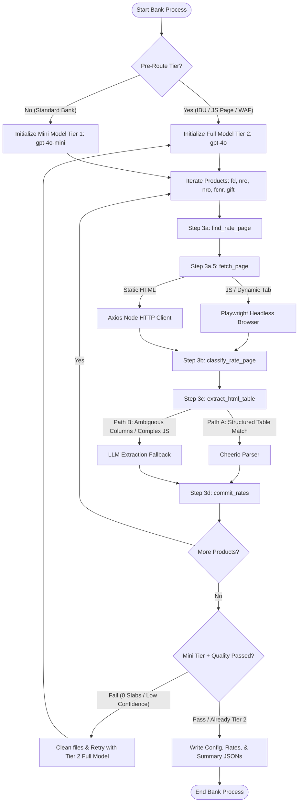

# Rate Discovery Agent — Azure AI Foundry Integration & Architecture Guide

This guide details how the **Rate Discovery Agent** works, its execution architecture, and how to configure, run, and host the agent using model deployments and services in **Azure AI Foundry** (formerly Azure AI Studio).

---

## 1. Agent Architecture & Execution Flow

The Rate Discovery Agent is a hybrid system combining **deterministic rule-based orchestration** with **LLM-powered semantic extraction** to discover bank deposit rate pages and extract structured interest rate slabs.

### Hybrid Orchestration Flowchart

The following diagram illustrates how a bank is processed, including Two-Tier Model Routing, Playwright crawling, Page Classification, and the Cheerio/LLM extraction fallback.



---

## 2. Core Execution Steps

### Step 3a: `find_rate_page` (Discovery)
* **Recheck Mode:** If a rate page URL is already cached in `bank-domains.json`, the orchestrator confirms the URL is live via a fast HTTP HEAD check before attempting crawling.
* **Discover Mode:** Uses a web search fallback or domain crawling to locate the interest rate page if no cache exists.

### Step 3a.5: `fetch_page` (Page Retrieval)
* The agent fetches the page content. To optimize token usage and request times, a shared per-run cache ensures that if multiple variants (e.g. Regular, NRE, NRO) point to the same URL, the page is fetched only once.
* It uses Playwright with anti-detection headers to bypass Web Application Firewalls (WAF) for JavaScript-rendered sites.

### Step 3b: `classify_rate_page` (Page Classification)
* The page content is analyzed to determine its structure: `html_static`, `html_js` (dynamic tabs), `pdf`, or `image`.
* This classification determines which downstream extractor is triggered.

### Step 3c: `extract_html_table` (Rate Extraction)
* **Path A (Cheerio):** Instantly parses standard HTML tables matching configured or predicted dimensions. It is fast, deterministic, and costs zero tokens.
* **Path B (LLM Fallback):** If table columns are ambiguous (e.g., multiple currencies, overlapping headers), or if dynamic clicks are required, the agent calls the deployed Azure AI Foundry LLM. It supplies the LLM with the cleaned HTML and bank context to extract the rate matrix.

### Step 3d: `commit_rates` (Validation & Saving)
* Extracted slabs are normalized (parsing interest rates, tenures, and currencies) and saved under `output/latest/<bank-slug>_rates.json`.

---

## 3. Two-Tier Model Routing (Cost Optimization)

To reduce Azure OpenAI consumption costs by up to 50%, the agent routes requests through two models deployed in Azure AI Foundry:

1. **Tier 1: `gpt-4o-mini` (Mini Model)**:
   * Used for ~70% of standard domestic bank runs.
   * Low token consumption costs.
2. **Tier 2: `gpt-4o` (Full Model)**:
   * Pre-routed for complex runs (GIFT City IBU, NRI runs, and JS-rendered pages).
   * Used as an automatic fallback if the Tier 1 run fails validation (e.g., returns 0 slabs or outputs "low" confidence).

---

## 4. Deploying & Using the Agent via Azure AI Foundry

### Prerequisites in Azure Portal / AI Foundry
1. Create an **Azure AI Foundry Hub & Project**.
2. Deploy the two required models inside the AI Foundry Project model catalog:
   * **Model 1**: `gpt-4o-mini` (Version `2024-07-18` or later)
   * **Model 2**: `gpt-4o` (Version `2024-05-13` or later)
3. Note your **Project Endpoint URL** and **API Key** from the AI Foundry Portal under the "Overview" page.

### Environment Variable Configuration
Create/edit the `.env` file in the root of the `rate-discovery-agent` folder:

```bash
# Azure AI Foundry / Azure OpenAI Connection Details
AZURE_OPENAI_ENDPOINT="https://<your-foundry-resource>.openai.azure.com/"
AZURE_OPENAI_API_KEY="your-api-key-here"
AZURE_OPENAI_API_VERSION="2024-12-01-preview"

# Deployment Names mapped to AI Foundry Model Deployments
AZURE_OPENAI_DEPLOYMENT_MINI="gpt-4o-mini"  # Model deployment name for Tier 1
AZURE_OPENAI_DEPLOYMENT_FULL="gpt-4o"       # Model deployment name for Tier 2

# Search API Key (used during open-ended web discovery fallbacks)
BING_SEARCH_API_KEY="your-bing-search-api-key"
```

---

## 5. Running the Agent

### Running a Single Bank Discovery
Run a full discovery on a bank using the following CLI command:
```bash
node run-discovery.js "IndusInd Bank – IBU" "IFSC Banking Unit (IFSCA)" "Gujarat" --log-level debug
```

### Running Cohorts in Batch
Run the agent in parallel or sequentially across a predefined cohort of banks (e.g., the top 12 banks):
```bash
# Execute dry run to verify the bank targets
node run-batch.js --cohort top-12 --dry-run

# Run full batch extraction with a concurrency level of 2
node run-batch.js --cohort top-12 --concurrency 2
```

### Refreshing Rates Only
If the rate page URLs are already discovered and indexed, run the agent in rates-only mode to pull fresh interest rate tables directly (skipping the search phase):
```bash
node run-batch.js --cohort top-12 --rates-only
```

---

## 6. Hosting the Agent in Azure (Production)

You can containerize the agent and deploy it as an **Azure Container App (ACA)** or an **Azure Function (Custom Handler)** that runs on a cron schedule to keep your database updated.

### Production Environment Variables (ACA / Azure Function)
When running in Azure Container Apps, bind these variables:
* `BIRD_STORAGE="azure"`: Automatically uploads the output logs and rates data directly to an Azure Blob Storage container.
* `AZURE_STORAGE_CONNECTION_STRING`: Connection string to the storage account where `bank-domains.json` and output files will be persisted.
* Deploy using the provided **`Dockerfile`** in the repository root which installs Playwright, Node.js, and Chrome dependencies.
